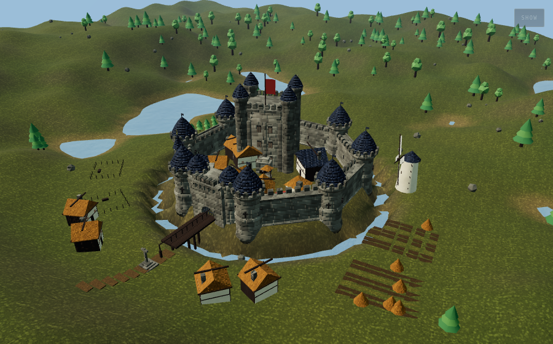

# Castellan (캐스텔런) — 한글화 포크

**땅을 깎고, 성을 쌓고, 그 안에 하루를 흘려보내 보세요. 과연 누군가 실제로 살아갈 수 있을지.**

하나의 HTML 파일로 동작하는 성 건설 + 정착지 시뮬레이션입니다. 이 저장소는
[otakuch/castellan](https://github.com/otakuch/castellan)(MIT 라이선스)을
한국어로 번역한 포크입니다. 게임 내 모든 인터페이스, 안내 문구, 건물 팔레트,
영지 평가 리포트, 연대기(로어) 생성문, 계절/시간대 이름이 한국어로 표시되며,
한국어 본문을 위해 IBM Plex Sans KR과 Gowun Batang 글꼴을 함께 불러옵니다.

원본 영문 README는 [README.en.md](README.en.md)에 그대로 보존해 두었습니다.

---

## 바로 플레이하기

**GitHub Pages:** https://sigco3111.github.io/castellan/

저장소 루트에 빌드된 `index.html`이 있으므로 Pages를 켜면 별도 설정 없이 바로
플레이할 수 있습니다.

**파일로 실행:** `index.html`(또는 동일한 내용의 `dist/castellan.html`)을
브라우저에서 열면 그것이 게임 전부입니다.

> github.com에서 `.html` 파일을 클릭하면 게임이 아니라 소스가 보입니다.
> GitHub는 저장소 파일을 텍스트로 제공하기 때문입니다. Pages나
> `raw.githack.com` 같은 프록시를 사용하세요.

---

## 게임 소개

두 가지 모드와 네 개의 탭으로 이루어진 작업대가 있습니다.

**건설.** 시드로 계곡을 생성한 뒤, 올리기/내리기/평탄하게/다듬기 붓으로 직접 땅을
깎습니다. 지형 높낮이, 수위, 언덕과 해자 여부를 조절할 수 있습니다. 그런 다음
서른여 종의 건물 팔레트에서 골라 배치합니다: 성벽, 망루, 성문, 주성, 오두막,
대저택, 주막, 예배당, 방앗간, 대장간, 빵굽는 집, 곡물창고, 비둘기집, 벌통, 부교,
활터, 약초밭, 봉화대, 밭, 과수원, 가축 우리, 다리, 오솔길, 울타리. 바닥의
화살표가 각 문이 향하는 방향과 성벽의 난간 쪽을 보여줍니다.

**운영.** 주민은 실제로 지은 것에서 나옵니다. 오두막에는 두 명씩 살고, 밭은
밭일꾼을, 노점은 상인을, 예배당은 수도사를, 가축 우리는 목자와 가축 떼를,
망루는 성벽 위 파수꾼을 만듭니다. 모두가 시간대에 따라 움직입니다. 아침에 나가서,
정오에 우물이나 빵집에서 쉬고, 저녁기도 후에는 주막으로, 밤 기도 전에는 집으로.
물 위를 걷는 사람도, 성벽을 뚫고 지나가는 사람도 없습니다. 직선 경로가 성벽과
만나면 가장 가까운 성문으로 돌아가고, 다리 없는 해자를 만들었다면 사람들이
강변에서 서성이는 것이 정직한 결과입니다.

**영지 현황.** 영지가 제대로 돌아가는지 열한 가지 척도로 평가하고 각각에 평이한
진단을 보여줍니다. 가장 재미있는 척도는 모든 문에서 세 갈래 광선을 쏘아 성벽
구간과의 교차 수를 세어, 성문이 자리한 틈을 메운 것으로 간주한 뒤, 실제로 성벽
안쪽에 있는 가옥이 몇 채인지 알려줍니다.

**연대기.** 영지에 이름을 지으면 그 이름으로부터 창립자, 강, 수호성인, 징조가
결정론적으로 생성됩니다. 같은 이름은 항상 같은 과거를 만듭니다. 이후 연대기는
지을 때마다, 그리고 하루가 지날 때마다 스스로 써 내려갑니다.

## 조작법 요약

| 입력 | 동작 |
| --- | --- |
| 왼쪽 마우스 | 손에 든 도구 사용 (배치 또는 땅 깎기) |
| 오른쪽 드래그 / Shift+드래그 | 카메라 회전 |
| 가운데 드래그 / Alt+드래그 | 화면 이동 |
| 휠 | 확대/축소 |
| Shift+휠, `[` `]` | 붓 크기 / 건물 크기 |
| W A S D, Q E | 이동, 회전 |
| 1–9, 0 | 도구 선택 |
| `,` `.` | 건물 회전 (Shift는 5°), 성벽 방향 뒤집기 |
| Z | 실행 취소 |
| 스페이스 | 하루 시작 / 멈춤 |
| R | 종 울리기 (다음 시간대로) |
| P | 사진 모드 |
| H | 패널 숨기기 |
| ? | 전체 조작법 |

## 기술 노트

- 빌드는 `node build.mjs` 하나로 끝납니다. `src/js/`의 28개 조각을
  `src/shell.html`에 합쳐 루트 `index.html`과 `dist/castellan.html`을 만듭니다.
  의존성은 CDN의 three.js뿐입니다.
- 모든 텍스처는 부팅 시 캔버스에 그려지고, 모든 돌은 그려진 단면을 돌리거나
  뽑아내어 만들며, 음악은 오실레이터로 합성되고, 영지의 역사는 지은 이름에서
  생성됩니다.
- 한글화는 DOM 기반 텍스트만 번역했으며(캔버스에 그려지는 문자열 없음),
  글꼴은 CSS 스택에 한국어 글꼴을 추가하는 방식으로 적용했습니다. 건물 키와
  그룹 키 등 내부 식별자는 원본과 동일하게 유지했습니다.

## 라이선스와 원작

- 원작: [otakuch/castellan](https://github.com/otakuch/castellan), MIT License.
  라이선스 전문은 [LICENSE](LICENSE)에 있으며 원본 그대로입니다.
- 이 포크의 번역 수정분도 동일한 MIT 라이선스를 따릅니다.
- 이 README의 스크린샷은 원작 저장소의 자료(`docs/screenshots/`)를 사용했습니다.
